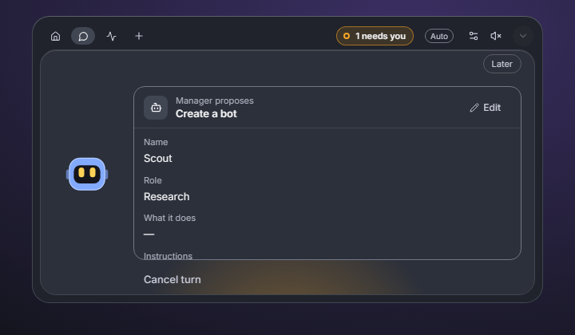
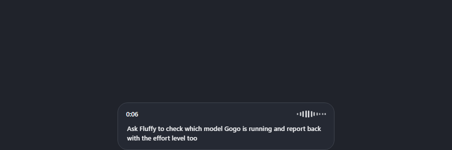

# Companion and dictation

> **What this is:** use the floating companion, its approval and chat views, and dictate into the composer on this device or, opt-in, through the cloud.
> **Status:** current; written for v0.1.0-beta.36 and updated for `main` on 22 October 2026
> **Last updated:** 2026-10-22

## Before you start

The companion is a separate window. It can stay open while the main window is in the tray. Dictation needs a microphone; the on-device engine also needs a speech model downloaded once.

Open the companion from the bottom of the sidebar, the profile menu, or the global shortcut if you left it on. At startup it can open itself (Settings › General, **Open the companion at startup**).

## The companion

### What it shows

The window has a compact form and an expanded form. The compact form shows a face, a name and one status line. The expanded form is a small copy of the main window, the same in every look: the list of your bots on the left, and the open bot's header and conversation on the right. Each look keeps its own bot art and status marks in the list; only Haze adds its status gradient.

The right-hand side shows one of these:

- **Chat:** the conversation with the open bot, using the same conversation as the main window. A bot with no conversation yet shows a ready message box, and your first message starts its conversation.
- **Approval or question:** the current approval or question replaces the conversation until you answer it.
- **Activity:** what the team is doing now, including working bots and recent finishes, and the reported tokens.
- **Settings:** sounds, focus mode, placement and size, teammates and remote.
- **File drop:** dropping a file on the companion offers it to the current conversation.

The buttons under the list switch between chat, activity and settings, and mute or unmute the sounds.

The companion is not a second brain. It shows the same state and sends the same commands as the main window, so both windows agree after the next update.

*The companion with a Manager proposal, shown in the retired Frost look. Fixture data.*

### Resize it

Drag any edge or corner of the expanded companion to resize it. It cannot become too small to read (520 by 340 points) or larger than your screen's work area, and it remembers the size across restarts. The **Make larger** button in its header grows it to a big size for working beside a game or another app, and the same button restores it. **Reset** next to Size in the companion settings returns to the default size. The compact bar keeps its fixed size. The companion stays on top of other windows. There is no separate chat-height choice any more.

### Move, snap and place it

Drag the window by its surface. It snaps flush to a screen edge when released near one, and remembers its position for each display. **Reset companion position** in Settings › General puts it back at the bottom centre of the main display.

Press the name area to open the companion's home. A close or collapse control is always present; the window never becomes impossible to dismiss.

### Focus mode and peeks

When a bot finishes, the companion shows a short "finished" banner with **Open**; it plays a soft cue if sounds are on. **Focus mode** suppresses those peeks and cues while leaving approvals and questions visible. It is a switch in the companion settings and in Settings › General.

### Keyboard

With the companion focused, `Ctrl+1` to `Ctrl+9` move to the first nine bots in the list and `N` jumps to the next bot waiting for you. These shortcuts do nothing while a text field has focus. Escape closes an error line or a menu.

### Sounds

The companion is the only surface that plays character sounds. Volume is set in Settings › General; zero is silent. The cue set is original and opt-in at the window level.

## Dictation

### Turn it on

Settings › Speech has a **Dictation** switch. When it is on, the composer and companion show a microphone and `Ctrl+E` starts and stops a recording. The live transcript appears in the composer as provisional text; you can edit it before sending.

If dictation is off, the shortcut does nothing. If no speech model is installed and the cloud is not allowed, Bitbots says that both engines are unavailable rather than failing silently.

### On-device engine

The default engine runs on this computer. The speech model is downloaded once and checked after download; it is not included in the installer. The choices are:

| Model | Languages | Size | Notes |
| --- | --- | --- | --- |
| Parakeet TDT v3 | 25 European languages | about 671 MB | The recommended model; punctuation, capitalisation and word timing. |
| Parakeet TDT v2 | English | about 661 MB | Faster, with similar accuracy. |
| Zipformer Streaming EN | English | about 90 MB | Lightweight, with live partial text. |
| Whistle | English, German, French, Spanish, Italian, Dutch, Polish | about 18 MB (17 MB model and a 1.5 MB engine) | Very small and quick to download. Less accurate than Parakeet and punctuation is not documented. Windows only. |

While you speak, the island shows your words as they arrive: every on-device model sends a provisional line about once a second and keeps the words in place at each pause. Cloud dictation sends the whole recording when you stop, so its island says "Words appear when you stop." instead of showing nothing.

Whistle runs through Cactus's own Windows engine, which Bitbots downloads with the model, checks against a fixed fingerprint and runs as a separate local process. Your voice goes to that process as a short temporary file that is deleted at once; it is never sent anywhere.
Your recording is processed on this computer and is not written to disk by Bitbots. The model and its download progress are managed in Settings › Speech.

### Cloud dictation (opt-in)

Cloud dictation is off until you allow it. The confirmation says exactly what happens: each recording is sent to OpenAI's ChatGPT transcription service through the Codex sign-in already on this computer, read-only. Bitbots does not store or log the recording, the transcript or the sign-in. If the cloud is unavailable, dictation falls back to the on-device model when it is installed.

Bitbots identifies itself to the service and does not pretend to be another app. Choose **On device** in Settings to stop using the cloud. Turning the master switch off stops both engines.

### Privacy

- The on-device path sends nothing anywhere.
- The cloud path sends only the audio for the current recording.
- No audio, transcript or cloud sign-in is saved by Bitbots.
- The companion's cues are generated locally and are not speech recordings.

*The dictation island in its live state. This is the preview harness, so the waveform is generated, not captured. Fixture data.*

## Check the result

- The companion follows the current bot and shows the same approval that the main window shows.
- Dragging it to an edge and releasing snaps it; restarting Bitbots restores the position.
- `Ctrl+1` focuses a teammate, and `N` moves to the next waiting bot.
- The microphone appears only when dictation is on.
- A recording produces a transcript in the composer and leaves no file behind.
- With the cloud disallowed and no model installed, the error names both missing engines.

## If something fails

**The companion is not on screen.** It may be on another display. Use **Reset companion position**, or turn it off and on from the sidebar. Check that it is not hidden behind the main window.

**The companion does not follow the light theme in Stone.** Stone (stored as `blobots`) keeps its dark companion by design. The dictation window picks up a theme change only when it is created.

**The companion has no approvals.** Approvals from remote apply only to remote devices; locally, the card appears in the companion when it is open. Focus mode hides peeks, not approvals.

**`Ctrl+E` does nothing.** Dictation is off, the shortcut belongs to another app, or no text field has focus. Turn it on in Settings › Speech and focus the composer.

**A model download stalls.** Reopen Settings › Speech and resume; the download is resumable and checks each part. Do not delete the app's speech files by hand while Bitbots is running.

**The cloud says verification is required.** That is OpenAI's anti-bot check rejecting the request, not a Bitbots sign-in failure. Use the on-device engine. Bitbots does not try to defeat the check.
