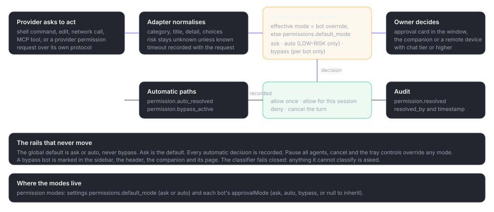

# Conversations and approvals

> **What this is:** run a conversation, understand what a turn is doing, answer permission requests safely, and recover when a turn fails or is limited.
> **Status:** current; written for v0.1.0-beta.35
> **Last updated:** 2026-10-19

## Before you start

A conversation belongs to one bot and one working folder. The first prompt starts the thread with the coding agent. You do not need to start anything yourself, and you do not need to keep the details panel open.

## Steps

### Send a prompt

Type in the composer and press Enter. Use Shift+Enter for a new line. The model, effort and permission controls beside the composer apply to this conversation from its next turn.

Bitbots starts the turn when there is room to run it. The overall limit is **Bots working at once** (default 4, range 1–16). There is no per-bot limit; one bot may run several conversations.

### Send while a bot is working

You choose what happens in Settings › General:

- **Steer** sends guidance into the running turn. Only Codex accepts this in the current release; other coding agents fall back to queuing.
- **Queue** stores the prompt until the current turn ends. A conversation can hold up to 20 queued items.

A queued item can be edited, reordered, sent now, scheduled or deleted. **Send later** gives it a due time (at least 5 seconds, at most 366 days away). Scheduled items still fire while the queue is paused.

The queue sends the next item after a completed turn. A failed or cancelled turn pauses it, so nothing fires unexpectedly. After a restart, a conversation with plain queued items starts paused. A send interrupted by a restart becomes **failed** with "Interrupted by a restart. Check the conversation before sending again." and is never resent automatically.

### Read a turn

A turn moves through **starting**, **working**, **waiting for approval**, **completed**, **failed**, **cancelled** or **limited**. The conversation shows the reply as it streams, tool cards with their state, and file changes with added and removed lines. A finished turn keeps its messages, tools and files.

The details panel shows the coding agent and the conversation facts. Usage is recorded per turn against the model, and a model with no known price is shown as unknown, never as zero.

*A working conversation. The plan card is a proposal; nothing changes until it is approved. Fixture data.*

### Use plan mode

Plan mode asks the bot to read and propose before it edits. The coding agent's plan can arrive as a card with steps and a **Yes, plan it** action. Approving the plan starts the implementation; replying with edits changes the plan instead. Plan mode is a per-conversation setting and can be pinned even while the bot is locked.

The plan is not an approval for individual commands. Permission requests still arrive as their own cards.

### Answer an approval

A permission request names the action, the tool and a short detail (a command, a path, a link or the tool name). The buttons are the options the coding agent offers, shown as allow once, allow for this session and deny; an agent may offer fewer.

*How a permission request becomes a decision. Bitbots applies the mode; you answer only what the mode leaves open.*

- **Allow once** answers this request only.
- **Allow for this session** answers this kind of request until the conversation ends, where the coding agent supports it.
- **Deny** refuses the action. The bot can propose another way or stop.
- **Cancel turn** ends the turn.

The card is also shown in the companion when it is open. Approvals can be answered from a remote device only if you turned on **Approve requests from remote devices** and the device has the operator tier.

If you do not answer before the coding agent's timeout, the request expires. The conversation shows the failed or continued turn; cancel it and send again rather than waiting on a dead card.

### Choose how often you are asked

- **Ask first** is the default. Every request waits.
- **Auto** approves only low-risk actions: read-only tools inside the project, edits inside the project excluding hidden repository files and secret-looking files, and a short list of read-only commands. Network access, installs, deletion, writes outside the folder and unknown commands still ask. Anything Bitbots cannot judge asks you.
- **Full access** approves everything and, where the coding agent supports it, starts it without asking. It needs an explicit choice and is always marked in the interface.

Bitbots keeps a record of every automatic decision, with a short description of the action. When a coding agent is allowed to run without asking, Bitbots records that too. Pause all agents, cancel, the tray controls and restarting Bitbots never raise a mode.

### Handle a usage limit

A coding agent's usage window can put the conversation into **Limited**, with a reset time when the agent gives one. With the default setting on, the conversation resumes once at the known reset. With no reset time it waits for you; it never retries on an unknown window. A notice explains what happened.

### Search, archive and delete

Search finds conversation text on this computer. Archiving hides a conversation from the default list; **Include archived** brings it back. Deleting removes Bitbots' copy of the conversation and its saved details, and is refused while it is starting, working, cancelling or waiting for approval. It does not change the coding agent's own history.

## Check the result

- The turn reaches **completed**, with a reply and any tool or file cards.
- The queue is empty, or holds only what you deliberately added.
- The conversation's permission mode shows the mode you expect, including inheritance from the bot.
- Usage appears for the turn and the model.
- An approval you answered appears once, not repeatedly.

## If something fails

**A prompt will not send.** The conversation may be waiting for approval, the queue may be paused, or the overall limit may be full. Look at the state first; sending again does not skip the limit.

**Steering is refused.** The coding agent cannot steer. Switch the busy-send setting to Queue for that agent.

**The bot repeats a request.** Denying one action does not stop the bot proposing another. If it is stuck, cancel the turn and add a line to the prompt explaining the constraint.

**A turn failed after a restart.** Bitbots may give the coding agent a short summary of the last few messages and changed files so it can continue, and says so in a notice. The summary is not saved.

**The approval card is missing from the companion.** Approvals from remote are off, the companion is in focus mode, or the card arrived before the companion was open. Open the main window; the card remains in the conversation.

How it works: [conversation lifecycle](../reference/sessions-and-turns.md) and [approvals and permissions](../reference/approvals-and-permissions.md).
