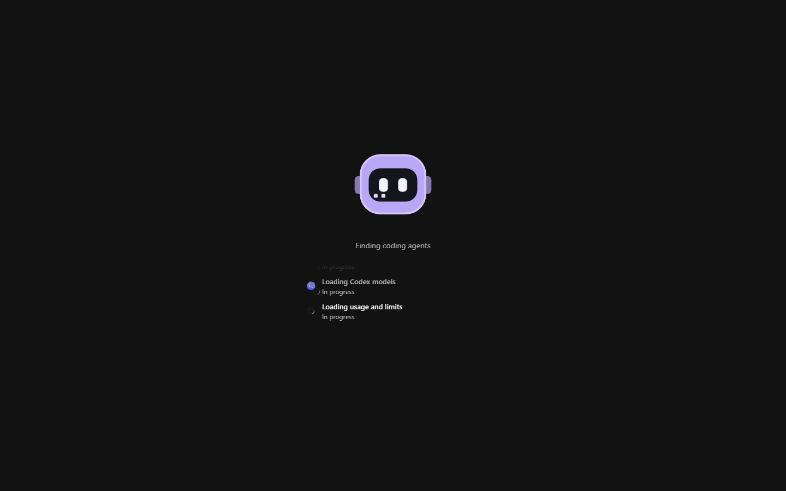
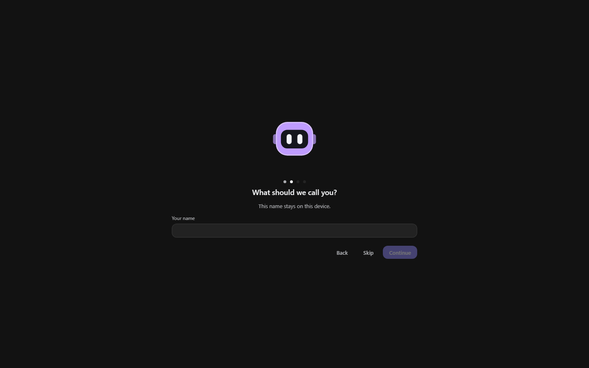

# The five-minute path

> **What this is:** install Bitbots, finish onboarding, make a bot and send the first prompt.
> **Status:** current; written for v0.1.0-beta.36 and updated for `main` on 22 October 2026
> **Last updated:** 2026-10-22

## Before you start

You need Windows, a coding agent you already use, and a signed-in account for it. Bitbots does not create accounts and does not copy a coding agent's sign-in. Claude Code, Codex and OpenCode each keep their own login.

The installer is a standard Windows `.exe`. It is not signed with a Windows publisher certificate, so SmartScreen may warn on the first manual install; choose **More info**, then **Run anyway** only if you trust the download. This version updates itself from inside the app.

## Steps

### 1. Install and open

Run the installer and open Bitbots from the Start menu. Bitbots starts its background service and plays a short launch intro while it checks for coding agents. On the first run it asks for a name and offers the tour when it is done.

*The launch screen during discovery. The steps listed here are fixture data from the browser preview.*

The first launch may take a few seconds while the coding agents are checked. If one is missing, onboarding still continues; add it later and use **Scan again** in Settings › Agents.

### 2. Choose a look and a name

Onboarding has four steps:

1. **Choose your look.** Choose the Bitbots (Frost) or Blobots orb. Its name appears on hover or keyboard focus. You can change this at any time in Settings › Appearance.
2. **What should we call you?** The name stays on this device and is used in the app and in what the Manager knows about you.
3. **Coding agents.** Bitbots lists the three tools it can find and says whether each looks signed in. Install a missing tool in another terminal, then press **Scan again**.
4. **Meet your Manager.** Give the Manager a look, a name and a model. It is the permanent bot that plans across projects.

*Onboarding step two. The step dots at the top show the four steps; this is demonstration data.*

If you choose **Skip** for the name, the app continues with a neutral profile. You can set the name later from the profile menu.

### 3. Create your first bot

Open the sidebar menu beside the app name and choose **New bot**, or press the `+` button. The bot wizard asks for:

- a **name**, a **colour** and an **art style** — leave the art on Automatic to follow the app look;
- a **coding agent**, from the ones Bitbots found;
- a **model** and an **effort** level, or leave them at the default;
- an optional **project**, which gives the bot a working folder;
- an optional **description** and **instructions**, which become part of its personality.

You can change all of this later on the bot's page. A new bot is not a running program; it starts a coding agent only when you send a prompt.

### 4. Start a conversation

Select the bot, choose or create a conversation, and type in the composer. The first send starts the conversation. What you see next depends on the coding agent and the approval mode:

- the reply streams in as it is written;
- tool calls appear as activity cards;
- a permission request waits for you in the conversation and in the companion;
- file changes are listed with their diff.

*A conversation with a plan card, a quoted bot message and the composer. Fixture data from the preview.*

### 5. Check that it worked

A working install shows four things:

- the bot row in the sidebar moves through its state (starting, working, waiting for you) and settles back to idle;
- the conversation contains your prompt and the reply, not a placeholder;
- the details panel lists the coding agent and the conversation;
- Settings › Agents shows the coding agent as online with a version.

If Bitbots asks for a sign-in, follow the message on the coding agent's card. Bitbots does not hold the login for you.

## Check the result

- The coding agent is listed with a version and, where it reports one, a signed-in state.
- A turn reaches **completed** rather than staying in **starting**.
- Usage appears for the model you chose. A model with no known price is shown as unknown, not zero.
- The next prompt reuses the conversation and, where the coding agent supports it, resumes the same thread.

## If something fails

**No coding agents found.** The tool is not on your PATH, or Bitbots cannot run it. Install it, open a new terminal once to confirm it runs, then use **Scan again**. A tool that is installed but not signed in is listed separately and can still be configured.

**The turn fails immediately.** Open the coding agent's card and read its message. A signed-out tool, a missing program or an unsupported model name are different problems; the card names the one it found. Do not change the model across coding agents by hand: pick from the list the agent reports.

**Bitbots cannot reach its background service.** Use the connection banner's **Retry**. If it persists, close Bitbots completely, including the tray icon, and start it again. Export diagnostics from Settings › General before restarting if you need to report it.

**A permission card never resolves.** The coding agent may have timed out the request. Cancel the turn, then send again. Approval behaviour and the safe automatic cases are in [conversations and approvals](conversations-and-approvals.md).

**Windows warns about the installer.** That is expected for an unsigned installer. Bitbots still verifies updates from its release channel before installing them.
