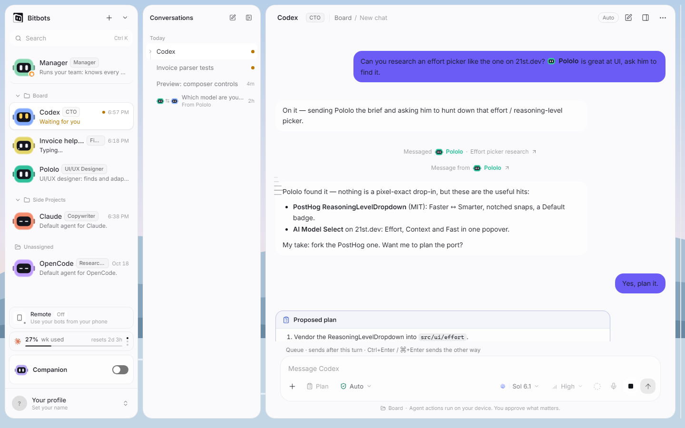
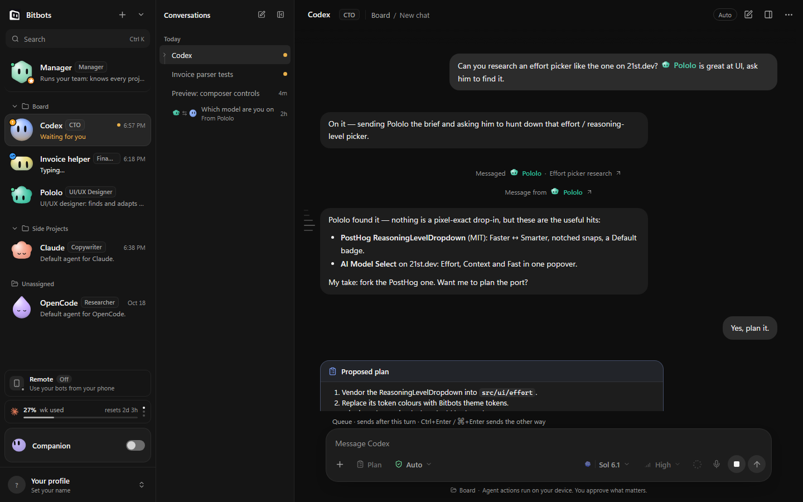
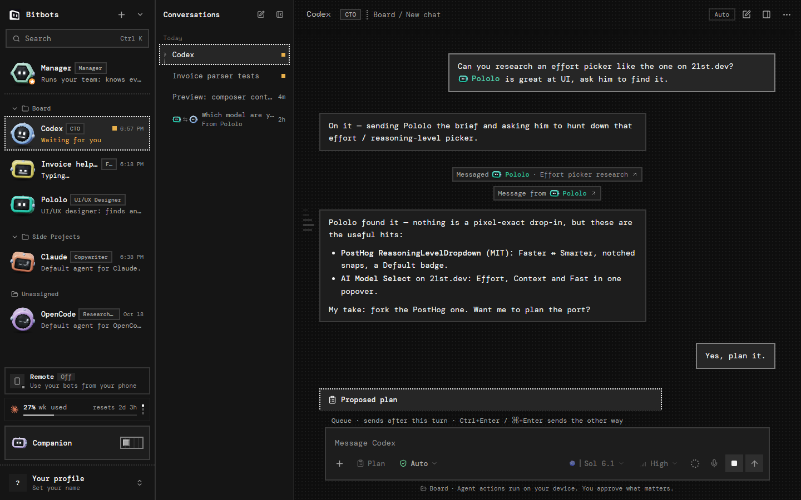
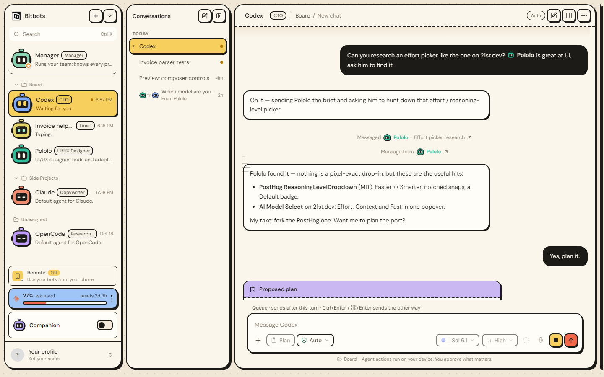
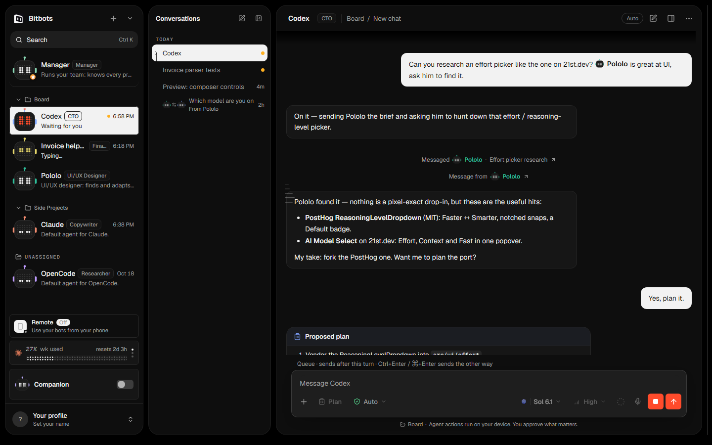

# Looks and appearance

> **What this is:** the five looks, what each changes, and how wallpapers, glass, fonts, accent and text size work.
> **Status:** current; written for v0.1.0-beta.35
> **Last updated:** 2026-10-19

## Before you start

Open **Settings › Appearance**. The page is ordered Look, Look options, Colour, Text. Bitbots saves your choice on this device and applies it straight away.

A **look** is not the same as a bot's **art**. The look styles the app; the art styles one bot. Leave a bot's art on Automatic and it follows the look. [Bots](bots.md) covers art.

## The five looks

### Bitbots (Frost)

The default. Flat translucent panels over a wallpaper, with hairlines and rounded rectangles. The see-through effect is used on the large surfaces only: the sidebar, conversation lists, conversation column, details panel, settings sheet, dialogs, menus and popups. Cards, rows, inputs and message bubbles stay flat, so the transparency does not stack up.

There is no glow, halo, decorative gradient or text shimmer. Floating menus have one soft shadow. The interface font is Inter unless you choose another.

*Bitbots (Frost), dark theme, Lake wallpaper. Fixture data.*

*The same look in the light theme. The wallpaper shows through the solid glass tint. Fixture data.*

### Blobots

The quiet, monochrome alternative. Panels are opaque and the chrome is black, grey and white; colour is reserved for bots and for status that needs attention. It is the look the original app shipped with, and it keeps its original component styling. It does not use wallpapers or glass, and its companion stays dark.

*Blobots in the dark theme. The bot art follows the look: glossy blobs unless a bot chooses otherwise. Fixture data.*

### Legacy

The original pixel look: a pixel grid, a pixel welcome, and pixel type. Legacy is for people who want the old app back, not a retro restyle. Its layout is the same; the type, borders and dithering are not.

*Legacy. The dotted borders and pixel type are the old app's; the bot art defaults to the 3D robot. Fixture data.*

### Pop

Retro, not pixelated. A cream paper ground with a faint dot grid, panels and cards with a bold ink outline, hard offset shadows with no blur, pastel fills and sticker-style chips. Body text is DM Sans; headings and the brand name use Bricolage Grotesque. Pop uses rounded rectangles, never pills or circles for the app's controls.

*Pop. The outline and the offset shadow are part of the style, so a control never grows when it is pressed. Fixture data.*

### Dot

Monochrome with one red accent. Selection inverts to an ink background. Body text is Geist, labels are Geist Mono, and Doto is for large numbers only. Meters and bars are rows and columns of dots, not continuous fills. Outlines are dotted.

*Dot. The red send button is the one accent; everything else is ink on paper. Fixture data.*

## Look options: wallpaper and glass

Wallpaper and glass belong to Frost. Other looks show a quiet line in their place.

- **Wallpaper:** Lake (default), Dusk, Bloom, Sand, or your own image. A custom image must be PNG, JPEG or WebP and no larger than 15 MB. Bitbots copies the image into its own files and remembers which one you picked. **Remove** returns to Lake.
- **Glass:** Solid (default), Balanced or Clear. Solid shows the least wallpaper and Clear the most. Solid is also what the companion and dictation windows use, because those windows cannot blur what is behind them.

## Colour: theme and accent

**Theme** is System, Dark or Light. System follows Windows and updates when Windows changes.

**Accent** is an optional colour, entered as a hex value such as `#e17a56`. It replaces the look's default accent for primary buttons, selection and focus. Bitbots chooses black or white text on the accent so the label stays readable. Leave it unset to use the look's own accent.

## Text: fonts, size and density

There are 24 bundled fonts in four categories:

| Category | Fonts |
| --- | --- |
| Sans | Inter, Geist, DM Sans, Manrope, Plus Jakarta Sans, IBM Plex Sans, Figtree, Sora |
| Friendly / display | Outfit, Nunito, Space Grotesk, Bricolage Grotesque |
| Mono | JetBrains Mono, Geist Mono, Fira Code, IBM Plex Mono, DM Mono, Space Mono |
| Pixel | Doto, Silkscreen, Pixelify Sans, VT323, Press Start 2P, Jersey 10 |

Defaults are per look: Bitbots uses Inter, Pop uses DM Sans, Dot uses Geist and Geist Mono; Blobots and Legacy keep their original fonts. **Default for this look** returns to those.

A font is loaded only when you choose it, so it does not slow down the rest of the app. A pixel font is allowed as the interface font; the smallest text stays readable at 11 px. **Text size** has four steps (Small, Default, Large, Larger) and **Density** three (Compact, Default, Roomy); both change spacing and type size, not the window zoom.

## Orbs, not screenshots

Each look card in Settings and onboarding shows one still orb: lake glass for Bitbots, matte stone for Blobots, pixel dither for Legacy, striped sticker for Pop and dot matrix for Dot. An orb has no window chrome, avatars, text or animation, and it looks the same in every theme.

## Check the result

- The whole window changes at once, including menus and dialogs; no area keeps the previous look.
- With Frost, switching glass changes how much wallpaper shows through the large panels but not the flat cards.
- A chosen font appears in headings and body text, and the code font appears in code blocks and diffs.
- The companion follows Frost, Pop and Dot. Legacy and Blobots keep their dark companion in both themes.
- A custom wallpaper survives a restart and returns to Lake after **Remove**.

## If something fails

**A custom image is refused.** It is over 15 MB or not PNG, JPEG or WebP. Resize it and try again.

**Text is clipped after choosing a pixel font.** Bitbots keeps an 11 px floor, but some pixel faces are wider. Choose a smaller text size or a different font; this is a property of the font, not a layout fault.

**The companion did not follow the theme.** The dictation window takes its theme only when it is created; close and reopen it. The companion follows a theme change immediately.

**A look looks wrong after an update.** Use **Default for this look** for fonts, then reselect the look. If the problem remains, export diagnostics and name the look and theme in the report.

How it works: [theme system](../reference/theme-system.md).
