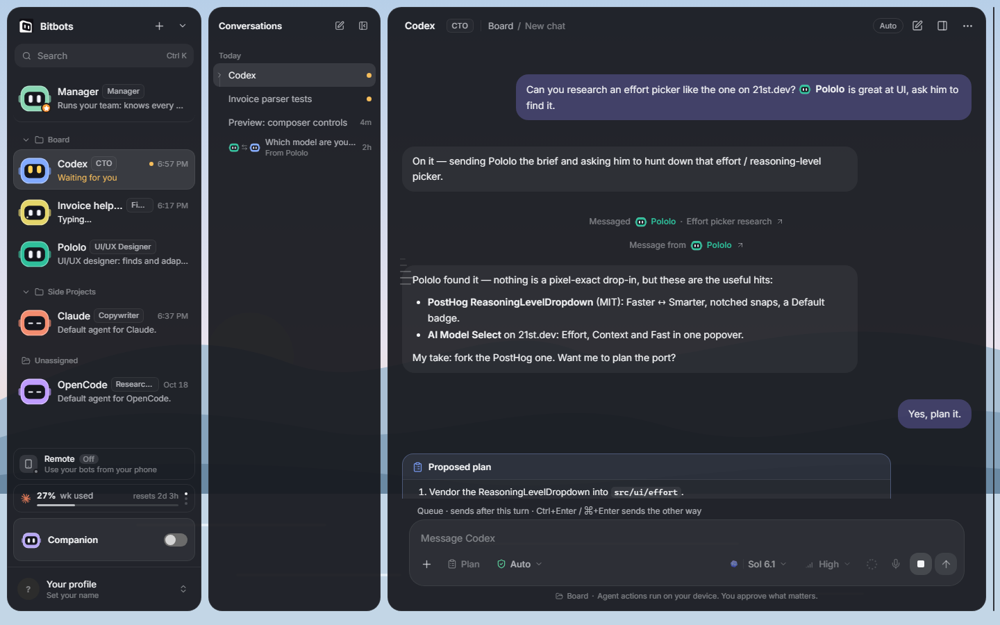
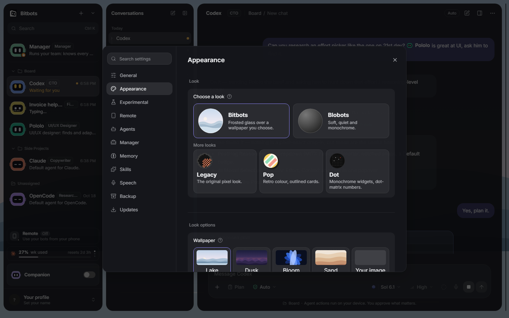

# What Bitbots is

> **What this is:** the shape of the product in one page: what you install, what a bot is, and how the pieces fit together.
> **Status:** current; written for v0.1.0-beta.36 and updated for `main` on 22 October 2026 (unreleased work is marked)
> **Last updated:** 2026-10-22

Bitbots is a local Windows desktop app for working with coding agents. It puts a team of bots in front of Claude Code, Codex and OpenCode, keeps their conversations in one window, and adds a small floating companion that shows what the team is doing.

It is not a hosted service. The app, your conversations and the coding agents' own sign-ins all stay on your machine. Bitbots does not copy a coding agent's sign-in into the app.

*The main window in the Frost look. Every screenshot in this library uses the browser preview with fixture data, not a real account.*

## The pieces

- **The app window** is where you work. It shows your bots and projects, the conversations, and the conversation itself.
- **The background service** runs alongside the app. It keeps your conversations, answers permission requests and stores your history. You do not start it yourself; Bitbots does.
- **The coding agents** are the command-line tools you already use. Bitbots starts one only when a turn needs it, and each tool keeps its own sign-in.
- **The companion** is a small always-on-top window with a bot face, short status, approvals and a compact chat.

A **bot** is a saved character with a name, a colour, an art style and instructions, plus the coding agent, model and permission settings it uses. A bot can own many conversations. A **conversation** is one thread with a coding agent; a **turn** is one prompt and everything that follows.

The permanent **Manager** is a bot with a special role. It works across every project, can read the team and the projects, and proposes new bots, projects and assignments. Its proposals wait for your approval. The one thing it can file without approval is an unassigned task draft on the task board.

Work for the bots can also be tracked on the **Tasks** board, opened from the sidebar header. A task is a record with a brief and a done goal; you give it to a bot, and you review the result. Unreleased on `main` as of 22 October 2026 (see [tasks](guides/tasks.md)).

## What you see

The main window is three columns: bots and projects, conversations, and the conversation itself. A details panel can show the coding agent, files and conversation facts. Settings holds general preferences, appearance, experimental features, remote, agents, the Manager, memory, skills, speech, backup and updates.

The two **looks** change the whole app: Bitbots (Frost) and Blobots. A bot's **art** is separate: 3D robot, 2D robot, Glossy or Hand-painted. The look decides the default art for a bot that has not chosen one; an explicit choice always wins.

*Settings › Appearance. The two orb choices are Bitbots and Blobots. Names appear on hover or keyboard focus. Fixture data.*

## Where your work lives

Your conversations, bots, notes, skills and settings are stored on this computer. The coding agents keep their own accounts; Bitbots never asks for or stores their passwords. Your choices in Settings are saved as you make them and apply the next time you open Bitbots.

## Remote access is optional

Remote is off by default. When you turn it on, you can reach your bots from a phone or another computer in one of two ways:

- **Tailscale** keeps the connection private to your own Tailscale network.
- **Native** serves a secure HTTPS address from this computer and asks for a username and password plus your approval for each new device.

Both methods show the same bots and conversations as the desktop app, and both limit what a device may do. You can revoke a device at any time.

## About the screenshots

The screenshots in this library use demonstration data from the browser preview, not a real account. They show layout and state; your own bots and conversations will look different. For the latest release checks, see the [release checklist](../../operations/release-checklist.md).

## Where to go next

- New to the app: [the five-minute path](guides/five-minute-path.md).
- Work on the board: [tasks](guides/tasks.md), and the rules behind it in the [task board reference](reference/task-board.md).
- Words used across the docs: [glossary](glossary.md).
- How it is built: [architecture](reference/architecture.md), with the conversation and permission rules in [approvals and permissions](reference/approvals-and-permissions.md).
