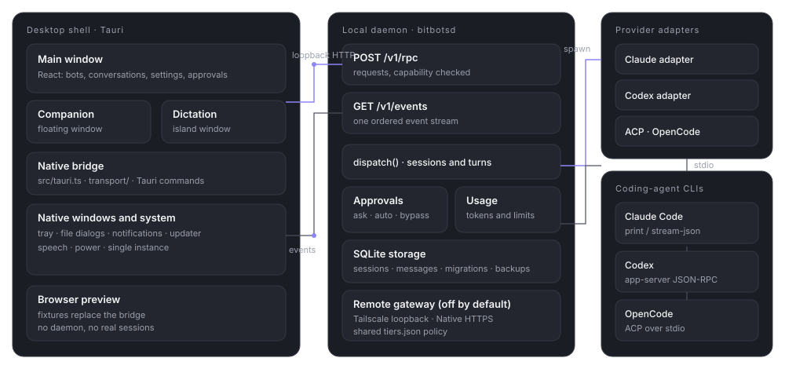

# Architecture

> **What this is:** the process and module structure of Bitbots: desktop shell, daemon, adapters, provider CLIs, overlay windows and the Remote gateway.
> **Status:** current; checked against the tree at v0.1.0-beta.35 on 19 October 2026. Line numbers may move.
> **Last updated:** 2026-10-19

## Purpose

Bitbots has one authority and several clients. The daemon owns sessions, turns, permission decisions, usage and storage. The desktop shell owns the windows and the operating-system integration. The provider CLIs do the actual coding work and keep their own logins.

This page is the map. The contract is in [IPC and events](ipc-and-events.md); the code-level details are in [daemon and storage](daemon-and-storage.md) and [runtimes and adapters](runtimes-and-adapters.md).

## How it works

*The desktop shell and the daemon are separate processes. The daemon starts provider CLIs as children and normalises their output into one event stream.*

### The desktop shell

`apps/desktop/src-tauri` is a Tauri application. It is responsible for:

- creating the main window, the companion and the dictation island;
- the tray icon, global shortcut and single-instance behaviour;
- native file dialogs and the token-based file commands;
- notifications, speech capture, power handling and the updater;
- starting, supervising and proxying the daemon.

The shell registers its commands in one handler list (`apps/desktop/src-tauri/src/lib.rs:2726`). The React code in `apps/desktop/src` runs in the webview and may only reach Tauri through `src/tauri.ts`, `src/desktopIntegrations.ts` and the `transport/` seam. UI components use the seam, not `@tauri-apps/*` directly.

The shell keeps the daemon capability in native memory. The renderer never sees it. A renderer call becomes a Tauri command, which becomes an authenticated loopback request. That is why a compromised webview cannot simply read the capability out of local storage.

### The daemon

`crates/bloblex-daemon` is shipped as `bitbotsd.exe` and listed as an external binary in `apps/desktop/src-tauri/tauri.conf.json:46`. It serves:

- `POST /v1/rpc`, one JSON envelope per request;
- `GET /v1/events`, a WebSocket upgrade that streams ordered events.

The listener binds `127.0.0.1` on an ephemeral port (`crates/bloblex-daemon/src/main.rs:4295-4299`). The daemon writes one bootstrap object to stdout before any log, containing the address and the capability. The shell reads it from the child-process channel. The capability is random, 256-bit, held in memory only, and checked in constant time on every request.

`dispatch()` (`crates/bloblex-daemon/src/main.rs:819`) routes methods. Retirement is explicit: `budget.*`, `pricing.*` and `subscription.*` return `unsupported` rather than pretending to work.

### Provider adapters and CLIs

Each provider has an adapter crate:

| Crate | Transport |
| --- | --- |
| `bloblex-adapter-claude` | Claude Code in print mode with stream-json output. |
| `bloblex-adapter-codex` | Codex app-server over JSON-RPC on stdio. |
| `bloblex-adapter-acp` | Agent Client Protocol, the provider-neutral adapter. |
| `bloblex-adapter-opencode` | The OpenCode launcher, using ACP with `--cwd`. |

The adapters translate provider messages into Bitbots events: assistant deltas, thinking, tool started and finished, file changes, permission requests, usage and the terminal turn state. No raw provider JSON reaches the UI contract. The provider process is a child of the daemon; a provider crash is an event, not an app crash.

### Shared crates

| Crate | Responsibility |
| --- | --- |
| `bloblex-protocol` | Request and response types for the daemon contract. |
| `bloblex-agent-core` | Shared agent logic used by the adapters. |
| `bloblex-storage` | SQLite, migrations, queries and the verified backup helper. |
| `bloblex-security` | Capability comparison and loopback checks. |
| `bloblex-runtime` | CLI discovery and launch specifications. |
| `bloblex-usage` | Usage helpers and the versioned official price table. |
| `bloblex-speech` | On-device dictation engine, catalog and capture. |
| `bloblex-wsl` | WSL host helpers. |
| `tools/bloblex-hook` | The bounded Claude hook helper. |

### Overlay windows

The companion and the dictation island are separate `WebviewWindow`s. They load the same bundle with a query flag that adds a surface class (`companion-surface` or `dictation-surface`). They have their own appearance listener or take the theme at creation, and they keep a dark base theme with a `data-surface-theme` value for the looks that follow the user's theme (FIX41).

The overlay windows never own a session. They send the same RPCs as the main window and render the same events.

### The browser preview

`apps/desktop/src/preview` replaces the Tauri bridge and desktop integrations with fixtures. The real `App` renders, so layout and state can be checked without a daemon. The preview cannot establish native behaviour, provider turns or real persistence. Every screenshot in this library was taken from it, and its data is labelled as demonstration data.

## The Remote gateway

Remote adds a second listener inside the daemon. It is off by default and has two methods, one active at a time:

- **Tailscale:** the gateway listens on loopback and `tailscale serve` publishes it.
- **Native:** the gateway binds the host's interfaces on its own port with TLS, a generated certificate and password sign-in.

In both cases the gateway calls `dispatch()` in-process. It never reads or exposes the capability, and the daemon API listener remains on loopback. The policy in `apps/desktop/src/remote/tiers.json` decides which methods a device may call; Rust and TypeScript read the same table.

## Key files

| Path | Responsibility |
| --- | --- |
| `apps/desktop/src/App.tsx` | The main window, state hydration, conversation and companion composition. |
| `apps/desktop/src/transport/nativeBridge.ts` | The seam over Tauri for UI code. |
| `apps/desktop/src-tauri/src/lib.rs` | Native windows, tray, daemon proxy, file actions, updates. |
| `crates/bloblex-daemon/src/main.rs` | Dispatch, turn driver, sessions, settings, Remote wiring. |
| `crates/bloblex-daemon/src/remote/` | Gateway, Tailscale, Native TLS and policy. |
| `crates/bloblex-storage/src/lib.rs` | Schema, migrations and queries. |
| `crates/bloblex-adapter-*/src/` | Provider protocols. |
| `apps/desktop/src/preview/` | Fixture bridge and preview fixtures. |

## Gotchas

- **Names lag the product.** Crates and binaries still say `bloblex` (`bloblex-daemon`, `bitbotsd`, `BLOBLEX_DB_PATH`). The product is Bitbots. Do not rename identifiers in prose.
- **`app.snapshot` is not incremental.** Events after the snapshot's sequence are applied in order; a gap or `replayAvailable:false` means fetch a fresh snapshot. Do not guess missing state.
- **One capability, one shell.** A second UI client must get the secret through the same authenticated native path. Do not add a localhost web page that calls the daemon directly.
- **Native is the only non-loopback listener, and only while on.** The daemon API, the Tailscale gateway and the browser preview all bind loopback.
- **The preview is not acceptance.** A passing preview check says the React tree renders; it does not say the native window, the daemon or a provider turn works.
- **The desktop crate needs a short path without an apostrophe.** Windows resource compilation fails on the main checkout's path; lanes use a path such as `D:\fx50` (see [development and testing](development-and-testing.md)).
