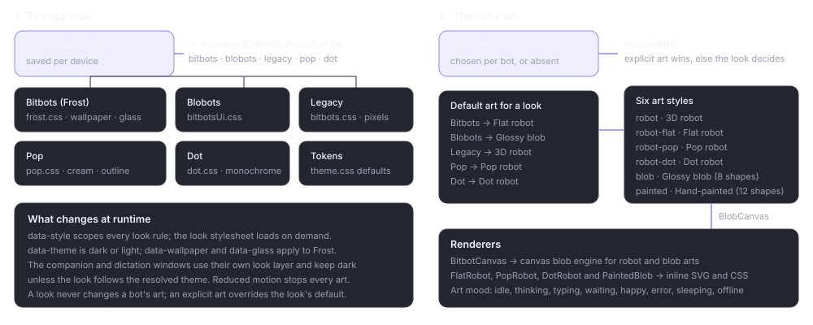
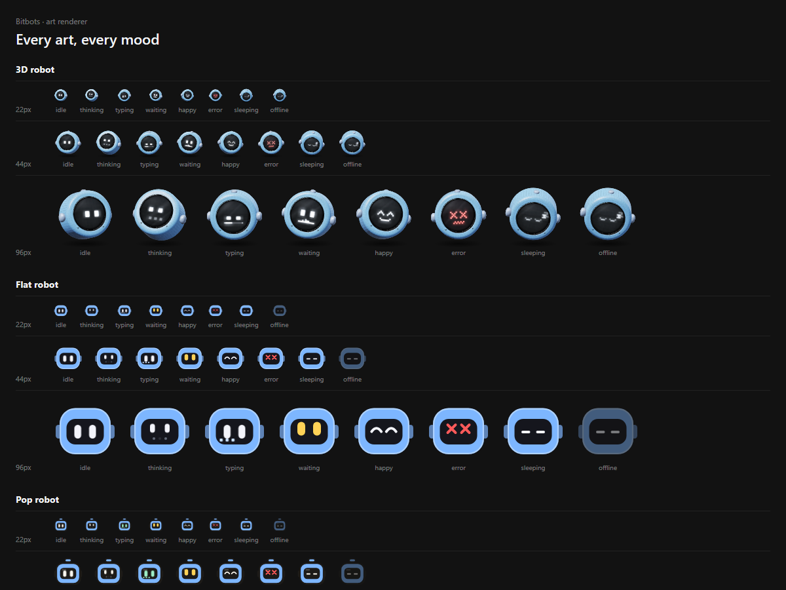
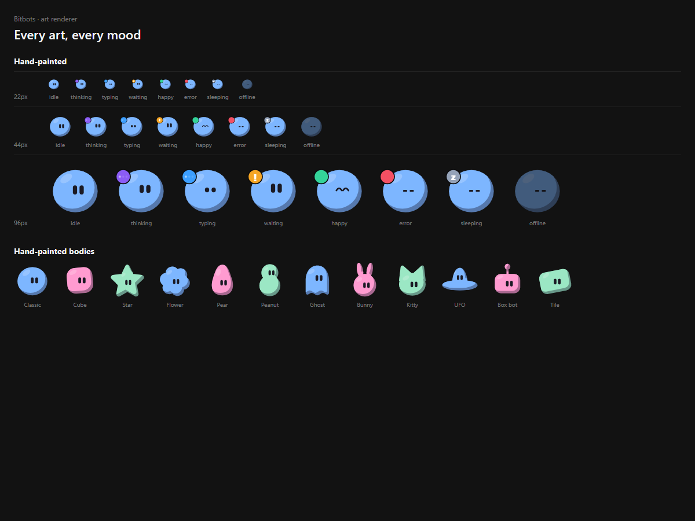

# Bot art system

> **What this is:** how a bot's face is chosen and drawn: `BlobCanvas` dispatch, the four offered arts and compatibility renderers, the look model, painted shapes, status badges and how to add an art.
> **Status:** current; checked against `BlobCanvas.tsx`, `art/art.ts` and `look/index.ts` on 19 October 2026
> **Last updated:** 2026-10-20

## Purpose

Every bot face in Bitbots goes through one component, `BlobCanvas`. It takes the same props everywhere: colour, size, mood, label and an optional look. The renderer is chosen by the bot's art, falling back to the app look. That is what keeps the sidebar, the conversation header, the companion and the character sheet consistent.

Art is not UI chrome. A look never draws a bot; it only decides the default.

## How the art is resolved



*The app look styles the window; `look.art` chooses the face. An explicit art wins; otherwise the look supplies the default.*

`BlobCanvas` reads the current look (`useThemeStyle()`), unless a `style` prop forces one for a preview. Then:

```tsx
switch (props.art ?? resolveArt(props.look, style)) {
  case 'robot': return <BitbotCanvas {...props} />
  case 'blob': return <ClassicBlobCanvas {...props} />
  case 'robot-flat': return <FlatRobot {...props} />
  case 'robot-pop': return <PopRobot {...props} />
  case 'robot-dot': return <DotRobot {...props} />
  default: return <PaintedBlob {...props} />
}
```

That is `apps/desktop/src/blob/BlobCanvas.tsx:348-358`. `resolveArt` maps saved Flat/Dot robot ids to 2D robot; other explicit art wins, otherwise it uses `defaultArtForStyle(style)` (`apps/desktop/src/blob/art/art.ts:104-118`).

A `style` prop overrides the document look for onboarding and look previews. An `art` prop overrides everything for the art sheet and the pickers. Production surfaces do neither.

## The four offered arts

| Id | Label | Renderer | Default for |
| --- | --- | --- | --- |
| `robot` | 3D robot | Canvas, the heavy shaded robot | Explicit choice |
| `robot-pop` | 2D robot | Inline SVG + CSS, four outlines | Bitbots |
| `blob` | Glossy | Canvas blob engine, eight shapes | Blobots |
| `painted` | Hand-painted | Inline SVG + CSS, twelve bodies | — |

The robot arts share one head language but change the eyes, not the whole head:

- **idle:** pill eyes that blink;
- **thinking:** smaller eyes glancing to one side;
- **typing:** stepped eye shapes and a row of pixels that types across the visor (Dot shows a pixel wave, never rolling eyes);
- **waiting:** raised, wide eyes in amber (red on Dot);
- **happy:** an arc pair;
- **error:** X eyes in red;
- **sleeping and offline:** flat lines, with offline dimmed.

The Dot robot has an antenna above its head. The Pop robot is outlined and sits on the Pop palette; the Flat robot is the plain Bitbots robot.

The new arts are inline SVG and CSS keyframes only: no canvas, no `requestAnimationFrame`, no per-instance window listener. Under `prefers-reduced-motion`, every animation stops and a still pose shows.



*The character sheet at `/preview.html`: 3D robot, Flat robot, Pop robot, Dot robot, Glossy blob and Hand-painted, each in every mood at three sizes. Fixture data.*

## The look model

A stored look is deliberately small (`apps/desktop/src/blob/look/index.ts:22-34`):

```ts
interface BlobLook {
  shape: BlobShape
  seed?: string | null
  traits?: TraitOverrides
  bot?: BotStyle
  art?: BotArt
  paint?: PaintedShape
}
```

- **shape** is one of eight: Circle, Pebble, Squircle, Capsule, Triangle, Hexagon, Cloud, Droplet. Older names migrate: `round` and `sun` become Circle, `organic` and `cat` become Pebble, `boxy` becomes Squircle.
- **seed** fills every trait the user has not pinned. A bot with no look uses its id as the seed, so its face is stable across sessions.
- **traits** are at most 48 pinned numeric positions with validated keys. They are clamped to 0–0.999999 on import.
- **bot** is the robot outline and colours for the Bitbots look.
- **art** is the explicit art.
- **paint** is the hand-painted body; omitted, it is derived from the blob shape.

`normalizeLook` validates a stored or imported look and returns null when it is malformed. It does not throw on unknown fields; it ignores them.

## The shiny blob's eight shapes

The eight-shape rule belongs to the glossy blob only. Each shape has soft shading and two equal, upright pill eyes mirrored around the centre. Eye tuning (size, height, spacing and squareness) changes only the eyes. Shuffle and Surprise me change the eyes and the colour, not the shape.

The shape vocabulary, trait keys and face fitting are adapted from the MIT-licensed blobatar project, with attribution in `docs/legal/third-party-notices.md`.

## Hand-painted bodies

There are twelve painted shapes (`apps/desktop/src/blob/art/art.ts:26-38`):

Classic, Cube, Star, Flower, Pear, Peanut, Ghost, Bunny, Kitty, UFO, Box bot and Tile.

The body is derived from the blob shape when `look.paint` is absent (`PAINT_FOR_SHAPE` in `apps/desktop/src/blob/art/art.ts:80-89`):

| Blob shape | Painted body |
| --- | --- |
| Circle | Classic |
| Squircle | Cube |
| Droplet | Pear |
| Cloud | Flower |
| Pebble | Ghost |
| Capsule | Peanut |
| Triangle | Star |
| Hexagon | Tile |

Hand-painted bodies do not move. Only their eyes animate. Their status appears in a corner badge borrowed from the glossy blob, using its colours. Mini avatars show a plain dot.



*`/preview.html?art=painted`: the twelve painted bodies at 64 px with idle eyes. Fixture data.*

## Moods

The classic blob has a large mood vocabulary; the art renderers share a smaller one (`apps/desktop/src/blob/art/art.ts:43-77`):

`idle`, `thinking`, `typing`, `waiting`, `happy`, `error`, `sleeping`, `offline`.

A blob mood maps onto one of these. For example, `working`, `file_activity` and `file_sending` become `typing`; `permission` becomes `waiting`; `success`, `file_ready` and `file_drop` become `happy`; `rate_limited` becomes `waiting`; `tool_activity` and `listening` become `thinking`.

The desktop mood comes from `ui/companionStatus.ts` and settles over time: a finished turn shows happy for about six seconds, then idle; a bot reads online for two minutes after activity, then idle, and sleeps after ten minutes. Working, approval, failure and offline states never time out.

Every mood and art can be inspected on `/preview.html`; `?art=<id>` narrows it to one art and `?theme=light` switches the sheet.

## Adding an art

1. Add the id to `BotArt`, `BOT_ARTS`, `ART_LABELS` and the robot/blob grouping in `apps/desktop/src/blob/art/art.ts:8-26`.
2. Add the mood mapping if the art does not use the shared one.
3. Add `defaultArtForStyle` only if a look should default to it.
4. Implement the renderer with the shared props. Inline SVG and CSS keyframes are the expected pattern for a new art; a canvas is allowed only with a measured need.
5. Stop every animation under reduced motion and leave a still pose.
6. Add the art to the character sheet and to `LookEditor` (the picker uses `data-style-option`).
7. Add tests for the dispatch, the default per look, the mood mapping and reduced motion.
8. Take a screenshot for this library and update `docs/design/design-system.md`.

## Gotchas

- **Art is per bot; the look is per app.** An explicit art survives a look change.
- **`paint` is derived, not copied.** Changing the blob shape changes the painted body unless `paint` is pinned.
- **A missing look is normal.** The seed comes from the bot id, so the same bot keeps the same face.
- **Do not add a window listener per instance.** The new arts are CSS-only on purpose; a sheet with dozens of bots would otherwise create dozens of listeners.
- **Reduced motion is a requirement, not a nicety.** Every art must have a still pose.
- **The status badge is not a second face.** For painted bodies it is a small corner badge, not a mood change in the body.
