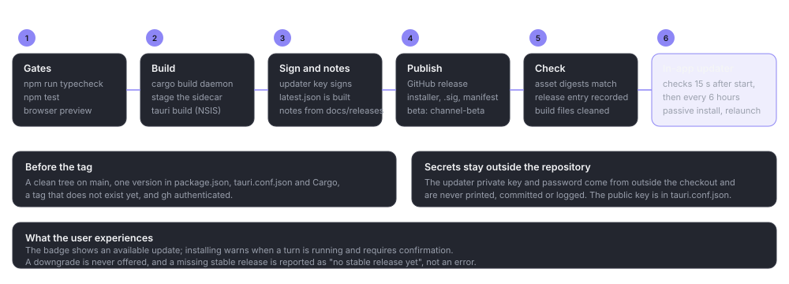

# Release and updates

> **What this is:** how a Bitbots release is built, signed for the updater, published and delivered to an installed app.
> **Status:** current; from the updater contract and the release scripts on 19 October 2026
> **Last updated:** 2026-10-19

## Purpose

A release is an NSIS installer plus a signed updater manifest. The app checks the manifest, verifies the signature and installs with a passive installer. Windows code signing and the updater signature are different things: the installer is not Authenticode-signed, and SmartScreen may warn on a first manual install.

The version is one value in four places: the root `package.json`, `apps/desktop/package.json`, `apps/desktop/src-tauri/tauri.conf.json` and the Cargo workspace (`Cargo.toml:24`). The release script refuses to publish when they disagree.

## The pipeline



*The gates, the build, the updater signature and manifest, the GitHub release and the in-app update.*

### 1. Gates

Before a release: `npm run typecheck`, `npm test`, the browser preview check for changed screens, and the Rust gates for touched crates. The release checklist records the exact commands and results.

### 2. Build

`scripts/bundle-windows.ps1` builds the daemon and the hook in release mode into an isolated Cargo target (`target\desktop-release` unless `CARGO_TARGET_DIR` is set), stages the sidecar with `scripts/stage-daemon.mjs`, then runs `tauri build`. The bundle target is `nsis` only, because an MSI cannot carry a `-beta.N` pre-release version.

`scripts/release-windows.ps1` wraps this. It checks:

- a clean working tree on `main`;
- matching versions everywhere;
- the tag does not exist;
- `gh` is authenticated.

### 3. Sign and manifest

The updater private key and password are read from outside the repository: `%USERPROFILE%\.bloblex-release\updater.key` and `updater.pass`, or `TAURI_SIGNING_PRIVATE_KEY` and `TAURI_SIGNING_PRIVATE_KEY_PASSWORD`. They are used only for the bundle build and are never printed, committed or logged.

`tauri build` produces the NSIS installer and its `.sig`. `scripts/make-update-manifest.mjs` writes `latest.json`:

```json
{
  "version": "0.1.0-beta.35",
  "notes": "…",
  "pub_date": "2026-10-19T00:00:00Z",
  "platforms": {
    "windows-x86_64": { "signature": "…", "url": "https://…/Bitbots_0.1.0-beta.35_x64-setup.exe" }
  }
}
```

The notes come from `docs/releases/<version>.md` when it exists, otherwise a default line. The manifest generator validates semver, the date shape, the URL and the signature text.

### 4. Publish

The release is created with the installer, its `.sig` and `latest.json`. A pre-release version is published as a GitHub pre-release. Every release also updates the rolling `channel-beta` pre-release with the newest `latest.json` (replacing the old one).

| Channel | Gets | Manifest |
| --- | --- | --- |
| `stable` | Non-pre-release releases only | `releases/latest/download/latest.json` |
| `beta` (default) | Every release | `releases/download/channel-beta/latest.json` |

`releases/latest` ignores pre-releases, so the stable URL resolves only after a normal release exists. A missing stable manifest is reported as "no stable release yet", not as an error.

A `-DryRun` runs everything except the `gh` calls and the tag. The public key is committed in `apps/desktop/src-tauri/tauri.conf.json` (`plugins.updater.pubkey`); the private key is never in the repository.

### 5. Check the assets

After publishing, compare the local installer's SHA-256 with the GitHub asset digest and record it in `docs/operations/release-checklist.md`. The installer needs no local copy afterwards; the published asset and the digest are the record.

### 6. Clean up build files

A release is not finished until the build leftovers are removed:

1. Remove the `node_modules` junction first, as a link only (`[System.IO.Directory]::Delete('<worktree>\node_modules')`), never recursing through it.
2. `git worktree remove --force <worktree>`, delete any remainder, then `git worktree prune`.
3. Delete the temporary lane branches.
4. Confirm with `git worktree list` that the paths are gone and report the space recovered.

The main checkout's `node_modules` and `target` stay, because they make later gates fast. A worktree with unreviewed work is never deleted.

## What the installed app does

- The channel defaults to beta while only betas exist. `autoCheck` defaults to on.
- The checker runs about 15 seconds after start and then every 6 hours. A found update emits an event and shows a badge; it never installs on its own.
- **Check now** works regardless of the automatic setting.
- Install downloads with progress events, then launches the passive installer, which closes and relaunches the app. If a turn is running or waiting for approval, the UI warns first and requires confirmation, because the daemon and turns end when the app exits.
- A network failure, bad signature, missing manifest or no stable release produces a short safe message. A downgrade is never offered.
- Development builds report "Updates unavailable in development builds" and never check.

The Tauri commands are `updates_get_state`, `updates_set_preferences`, `updates_check` and `updates_install`; the events are `bloblex-update-available` and `bloblex-update-progress` (`docs/operations/updater.md`).

## Release notes in the app

`docs/releases/*.md` is read by the app's What's New surface, which is why release notes are a protected path: they may gain a status line, but their content is not reorganised by the documentation pass.

## Gotchas

- **Version drift fails the release.** Update all four version locations together.
- **The updater key is not code signing.** A valid update can still trigger SmartScreen on a manual install.
- **A pre-release cannot use an MSI.** The bundle target is NSIS only.
- **Never print the key.** The scripts keep it out of logs; a manual command must too.
- **A clean gateway is part of the release.** A lane worktree left behind is an unfinished release, and deleting one before review loses work.
- **A missing stable release is normal during the beta.** Do not "fix" it by publishing a stable tag you did not test.
