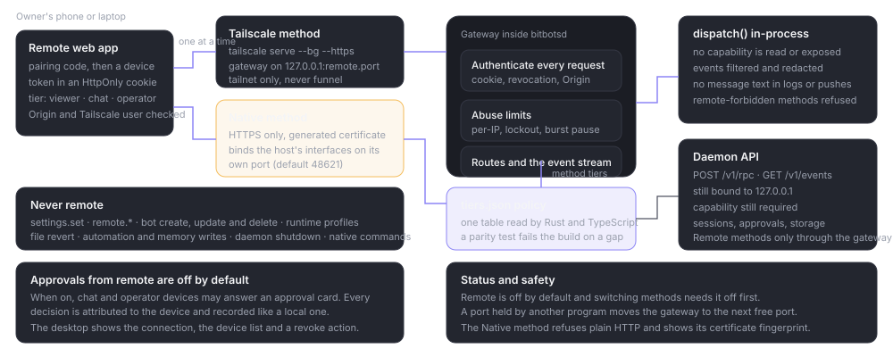

# Remote gateway

> **What this is:** how the Remote gateway is built: its two methods, routes, authentication, policy, event filtering, Native TLS and the threat model.
> **Status:** current; from the 17 October 2026 amendments and `docs/remote/PROTOCOL.md`. Remote has not been verified against a real phone in this library pass.
> **Last updated:** 2026-10-19

## Purpose

Remote lets a paired phone or another computer use a running Bitbots host without exposing the daemon API. The gateway is compiled into the daemon, off by default, and calls `dispatch()` in-process. It never reads, accepts or returns the daemon capability.

Two methods exist and only one is active at a time. Both share the gateway router, the policy, the cookie, the pairing records and the event stream.

## How it works

*Tailscale keeps the gateway on loopback; Native binds the host's interfaces with TLS. Both apply the same tier policy and dispatch in-process.*

### Tailscale

- The gateway listens on `127.0.0.1:<remote.port>` (default 48620).
- Bitbots publishes it with `tailscale serve --bg --https=443`, falling back to 8443 when 443 is taken.
- It never uses `tailscale funnel`, never runs `tailscale serve reset`, and never binds a non-loopback address.
- Turning Remote off removes only Bitbots' own serve handler.

### Native

- The gateway binds `0.0.0.0` and `[::]` on `remote.nativePort` (default 48621) while Native is on.
- TLS only, using rustls and a certificate generated by Bitbots. The certificate's subject alternative names cover the hostname, interface addresses, loopback and the known external address.
- Plain HTTP is dropped.
- The Tailscale listener is not running at the same time.

This is the only non-loopback listener in the product.

## Routes

| Route | Purpose |
| --- | --- |
| `GET /` and static files | The PWA, served only from paths in a startup manifest built from `BITBOTS_REMOTE_WEB_DIR`. Anything else is 404. |
| `POST /api/pair` | Consumes a pairing code. No device cookie required. |
| `GET /api/pair` | Polls the pairing outcome and sets the device cookie on approval. |
| `POST /api/login` | Native only: username and password. |
| `GET /api/ping` | Native only: fixed unauthenticated self-test marker. |
| `GET /api/me` | The device, host, approvals setting and quiet-hours state. |
| `POST /api/rpc` | One daemon envelope in, one out. |
| `GET /api/events` | WebSocket upgrade for events. |
| `POST /api/logout` | Clears the cookie and deletes its token hash. |

## Authentication

### Device cookie

A paired device gets a 256-bit token in an `HttpOnly; Secure; SameSite=Strict` cookie. Only the SHA-256 of the token is stored. Every `/api/*` request checks:

1. the cookie exists and is not revoked;
2. the Origin, when present, matches an allowed origin (or the Native certificate's addresses on the Native port);
3. the Host on Native matches the certificate's addresses and port;
4. the Tailscale login, when the header is present;
5. the device is not idle-expired.

A safe `GET`/`HEAD` may omit Origin same-origin, but Host is still required on Native. `/api/ping` is deliberately outside the Origin check so it can be opened from an address bar; it returns only `{"ok":true,"app":"bitbots","role":"remote-gateway"}`.

### Pairing

1. `remote.pair.begin` returns an eight-character code in two groups, a URL, a QR payload and an expiry. One offer is live; a new one cancels the old.
2. The device posts the code. A wrong code uses one of five attempts; after five, the code is burned. The first correct code locks the offer; later submissions are refused.
3. The desktop raises `remote.pairing.requested` with the device name, platform and Tailscale login when present.
4. The owner chooses viewer, chat or operator and approves, or rejects. Rejection burns the offer. Five minutes without a decision expires it.
5. The device polls `GET /api/pair`. On approval it receives the device cookie.

Every failure returns the same `pairing_invalid`, so a guesser cannot tell a wrong code from an expired or burned one.

### Native login

`POST /api/login {username, password, name, kind, platform}` verifies an Argon2id hash. A wrong pair returns `401 login_invalid` with the same answer for an unknown username. A locked-out source or a global pause returns `429 rate_limited`. A device with a valid cookie gets `200 approved`; otherwise the request starts the same owner approval as pairing and returns `202 pending`.

## Policy

The allowlist is `apps/desktop/src/remote/tiers.json`, read by Rust and TypeScript. Each method has a class (read, write, control) and a minimum tier. Events have a policy too: allow, redact or drop.

| Tier | Includes |
| --- | --- |
| viewer | Read state, transcripts, usage, runtimes, models, memory and automation lists. |
| chat | Viewer plus prompts, steer, cancel, queue, rename and archive. |
| operator | Chat plus permission replies, only while approvals from remote are on. |

Unknown methods are denied. Every `remote.*` method is `never`. Settings writes, bot and project lifecycle, runtime profiles, session deletion, file revert, automation and memory writes, daemon shutdown and native commands are `never`.

A parity test fails the build when a daemon method or event has no policy row, so a new method cannot quietly default to allowed.

## What leaves the host

The request pipeline filters the result and the event before it is sent:

- `app.snapshot` is redacted: no capability, no provider tokens, no instruction text, no environment values, no raw provider JSON.
- Events marked redact lose tool labels, patterns, paths and URLs by default.
- Message text never appears in logs, push payloads or the activity list.
- The activity list records a short content-free line for a connection, pairing, approval or refusal.

Attachments are not available in v1. A remote device cannot read the host filesystem.

## Native certificate and connectivity

- The certificate is generated with rcgen and stored with user-only access. The fingerprint is reported in `remote.status.native.fingerprint`.
- `remote.native.cert.regenerate` replaces it; devices then see a new warning and compare the new fingerprint.
- UPnP mapping is off unless the owner consents, and removing it removes only Bitbots' own mapping.
- A firewall rule is added or removed only through one elevated prompt the owner accepts; the result is `added`, `removed`, `declined`, `failed` or `unsupported`.
- The external address can be learned from UPnP or typed by the owner. The status says whether the address looks like carrier NAT.

Abuse limits apply to every unauthenticated route: per-IP rate limits, lockout after repeated failures, and a global pause on a burst. Each writes a content-free activity line.

## Threat model and release gate

`docs/remote/THREAT_MODEL.md` covers the Tailscale path in sections 8 and 11 and the public-internet path in section 12. The gate was waived once for `v0.1.0-beta.30` and remains owed before a non-beta release. The OpenCode lane's library pass did not exercise a live tailnet, a real phone, a certificate warning or a firewall prompt.

## Testing

- Policy parity: `remoteTiers.parity.test.ts` compares the JSON table with the daemon dispatch and the event policy.
- Cookie and transport: `deviceApi.test.ts`, `remoteTransport.test.ts`, `serviceWorker.test.ts`.
- UI: `RemoteApp.mounted.test.tsx`, `RemoteSettings.mounted.test.tsx`.
- Rust: `crates/bloblex-daemon/src/remote/tests.rs` covers pairing, rate limits, Origin and Host checks, revocation and Native startup.
- Live: not run in this pass. A live check needs a tailnet, a second device and a certificate exception.

## Gotchas

- **Two methods, one at a time.** Switching needs Remote off first.
- **The gateway is not the daemon API.** It has no capability and a different authentication model.
- **`/api/ping` is intentionally public.** Keep it content-free; it is the one route outside the Origin check.
- **A new method is denied until it has a policy row.** Do not add a fallback allow.
- **Native's certificate is not a public CA certificate.** The warning is expected; the fingerprint is the check.
- **Remote is not a remote desktop.** It cannot read files, change settings or run native commands.
