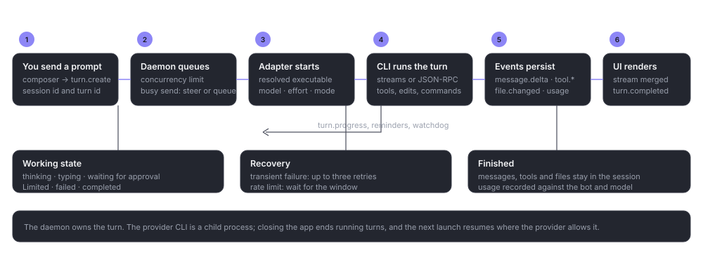

# Sessions and turns

> **What this is:** the lifecycle of a conversation and a turn, including admission, the queue, retries, the usage-limit watchdog and what survives a restart.
> **Status:** current; behaviour checked against `queue.rs`, `retry.rs`, the storage watchdog queries and the IPC contract on 19 October 2026
> **Last updated:** 2026-10-19

## Purpose

A **session** is the daemon's record of a conversation. A **turn** is one prompt and the work that follows. The daemon owns both; the provider CLI owns its own thread or session id, which Bitbots stores so it can resume.

The hard part is not starting a turn. It is deciding what to do when a turn is slow, a provider is overloaded, a usage window closes, the app restarts, or the user sends while the bot is already working. This page covers those paths.

*The turn path. The daemon admits and records the turn; the adapter talks to the provider; the UI renders the event stream rather than the provider's raw output.*

## Lifecycle

### Creation

`session.new` needs exactly one of `agentId` or `runtimeId`, plus a project path. A bot session derives its runtime from the bot; a legacy runtime-only session has `agentId:null`. The session starts idle and owns no provider process until the first prompt.

### Admission

`session.prompt` validates the body, reloads the bot's execution options, and asks for a turn. Admission is:

1. the global limit **Bots working at once** (default 4, range 1–16);
2. no per-bot cap (removed in FIX39);
3. for an automation run, its own concurrency limit and runtime cap.

Budget admission is retired. `budget.*` returns `unsupported`; a turn is not stopped by a budget.

A preflight rejection (closed execution gate, unsupported option, unknown model against an authoritative catalog) writes the user message, an error turn and an `exec.options.rejected` event, and does not reserve concurrency or deliver the prompt.

### Turn states

A turn is stored with a state and a terminal outcome:

- **starting**: admitted, adapter not yet streaming;
- **working**: the provider is running;
- **waiting for approval**: the provider asked and the daemon is waiting for a person;
- **completed**: a terminal result arrived;
- **failed**: an error ended the turn;
- **cancelled**: the user or a control stopped it;
- **limited**: the provider's usage window is exhausted (the session, rather than only the turn, carries this).

A session state mirrors the latest turn, with additional states for recovery (`retrying`) and `limited`. Events update the stored state; the UI never sets it.

### Messages, tools and files

Messages have stable ids and a sequence. A streamed message and its final form share the id. Tool calls have a state and may carry a short label, a pattern, a URL or a path where the provider supplied one. File changes record the path, operation and added/removed lines; a diff is stored when available.

Only `message.completed` makes a message final. A disconnect does not promote a delta to a finished message.

### Completion and the queue drain

When a turn completes on an idle session, the queue drains once. `turn.error` or `turn.cancelled` pauses the queue if items remain, so nothing fires unexpectedly. The next user action or **Resume queue** clears the pause.

### Cancellation and closing

`session.cancel` asks the provider to cancel and reports whether it supports it. `session.close` closes the adapter process while keeping the persisted session. Closing the app ends running turns, because the provider children end with the daemon.

### Deletion

`session.delete` removes Bitbots' record and its child data. It is refused while the session is starting, working, cancelling or waiting for approval. It does not touch the coding agent's own history.

## The durable queue

The queue lives in SQLite, not in the provider. Each item has `kind` (`user`, `send_later`, or the internal `retry`), a status (`queued`, `sending`, `failed`), a due time, a position and an error.

- The cap is 20 items per conversation.
- A scheduled item must be at least 5 seconds and at most 366 days away.
- Scheduled items are exempt from the pause and fire from a one-second loop when the session is idle.
- An item that sends more than 60 seconds late appends the notice "Scheduled message sent N min late."
- A send interrupted by a restart becomes `failed` and is never resent automatically.
- A failed item stays until deleted or sent with `send_now`.

The queue is drained under a per-session lock so two drains cannot send twice. Mutation RPCs are `read_only` on a side conversation and `not_found` for a missing or archived session.

## Retry and the usage-limit watchdog

### One decision owner

For a terminal turn, the daemon elects one recovery owner by claiming `retryDecision` on the turn row. Two paths (the adapter callback and the watchdog) cannot both schedule a continuation.

### Automatic retry (transient)

With `experimental.autoRetry` on, a terminal error may schedule a retry only when:

- the error carries an `overloaded` or `rateLimited` hint;
- provider delivery was `acknowledged`, not `unknown` (resending an unknown prompt could charge twice);
- the failure is not an auth failure;
- the turn has not exceeded its attempt cap.

Overloaded retries use exponential backoff (`5s × 2^(n-1)` plus jitter) and at most three attempts. A rate-limited failure now becomes the **Limited** state rather than being retried by this switch.

Every decision is stored as `{decision, reason, at}` on the turn. Decline reasons are stable codes (`disabled`, `not_acknowledged`, `no_hint`, `auth_required`, `unknown_reset`, `too_long`, `max_attempts`, `superseded`, `pending_retry`, `session_unavailable`, `cancelled`).

### Limited state

A usage limit sets the session state to `limited` and stores `limitedUntil` when the provider gives a reset time. With `experimental.resumeAfterUsageLimits` on (the default), the one-second sweep picks up sessions whose window is due, creates exactly one durable continuation with the prompt "Continue where you left off.", and resets the state.

A recovery counter caps continuations at three per conversation. An expired window is not re-armed from the same reset (the last reset is kept as a watermark). With no reset time the session stays limited and waits for the user; it never guesses a window. An automation session is excluded from the watchdog.

### After a restart

A run left working by an unclean exit is marked interrupted. For an ordinary session, the next prompt carries one bounded recap block: the last eight user and assistant messages (600 characters each), up to twelve changed file paths, 6,000 characters in total. It is added to that one prompt, never stored or logged, and the notice says a fresh session was started. An overdue retry (more than ten minutes) is dropped with a notice.

### The three-recovery cap

The cap applies to the watchdog and continuation path, not to an ordinary user prompt. It is there so a conversation cannot loop forever on a provider that keeps failing at the same point.

## Side conversations and automations

A side conversation is a session with `link.kind: "side"`, its own provider thread and a link to the origin. It is read-only to the remote client and refuses queue mutations.

An automation session has `link.kind: "automation"`, the automation and run ids, a pinned approval mode and a runtime cap. It is excluded from the watchdog continuation path because the scheduler owns its retry policy.

## Execution evidence

Each turn can have an execution snapshot: what was requested, what was applied and what evidence the provider gave. `exec.snapshot.get/list/latest` read them. The payload excludes instruction text, environment values, launch arguments, file paths and raw provider JSON. A rejection is evidence, not a success.

## Check the result

- A turn's state moves forward once and ends in a terminal state.
- A queued item is present in `session.queue.list`, and disappears once its prompt is accepted.
- A retry produces one `turn.retry_scheduled` event, not several.
- A limited session shows a reset time when one is known, and resumes once after it.
- A restart does not duplicate a prompt or a retry.

## If something fails

**The session is stuck in starting.** The adapter may be waiting on a provider process that never started. Cancel, read the runtime message, then retry. Do not send more prompts into the same stuck turn.

**A retry never fires.** The switch may be off, the delivery may be unknown, the hint may be missing, the wait may exceed `retry.maxWaitSecs`, or the cap may be reached. The decision row names the reason.

**A limited session does not resume.** It has no reset time, the feature is off, it has used three recoveries, or it is an automation session. A user prompt clears the wait.

**A queued item vanished.** It was accepted and became a message, or it failed and was deleted. The conversation shows the accepted message; a failed item is listed with its error.
