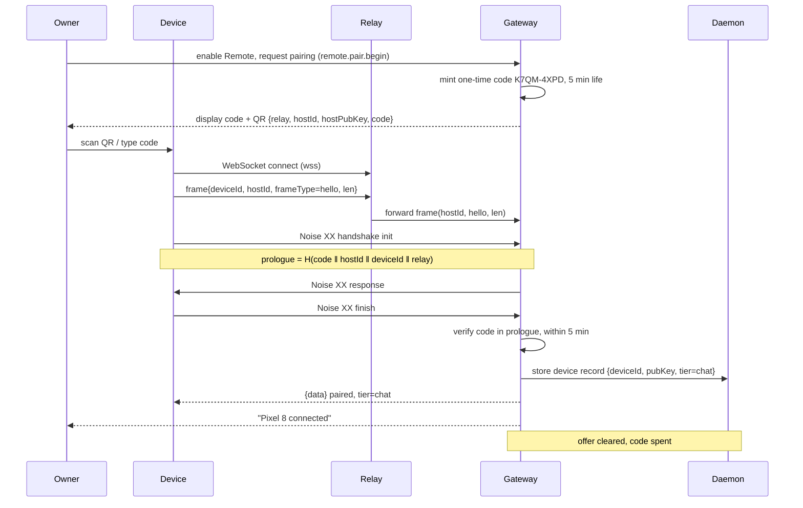
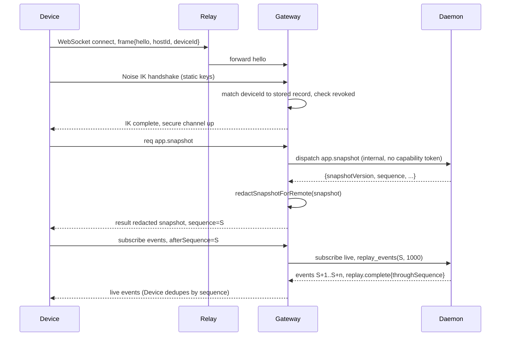
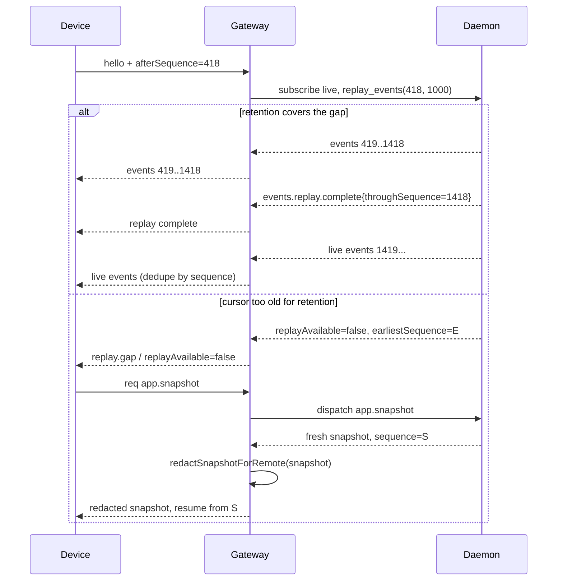
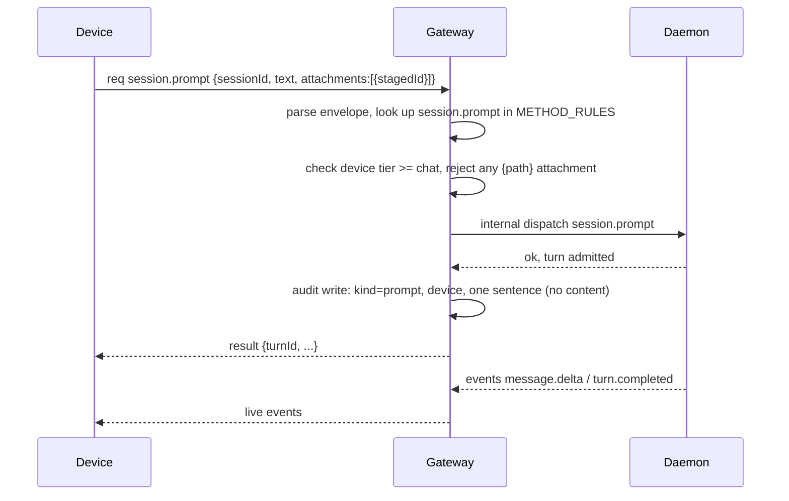
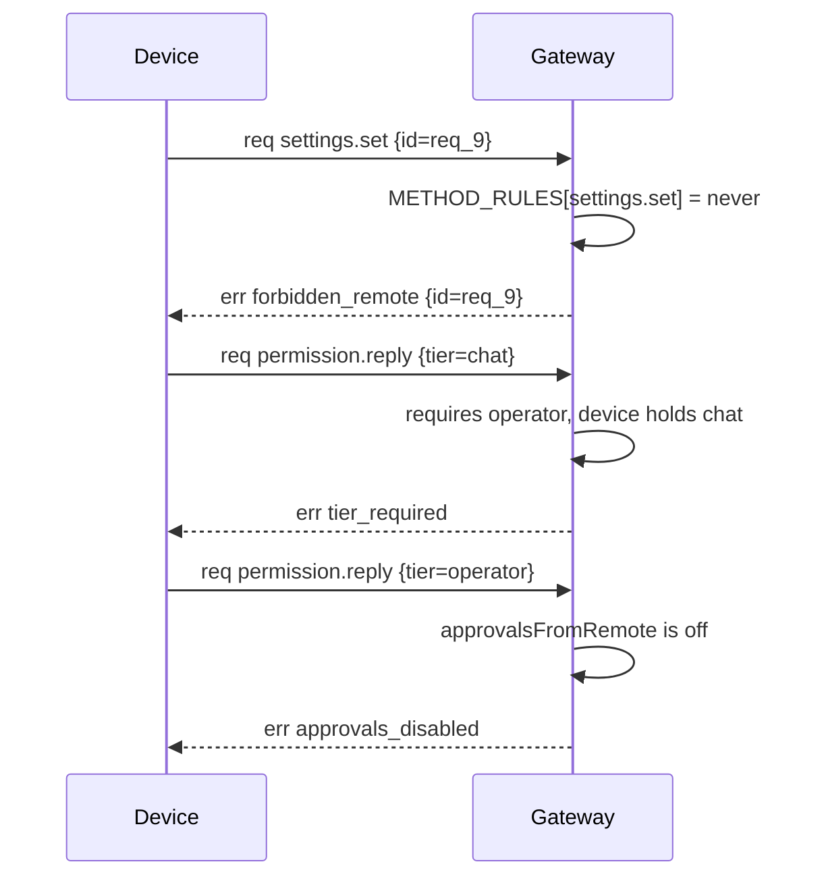
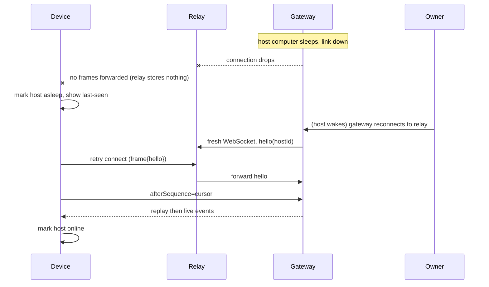
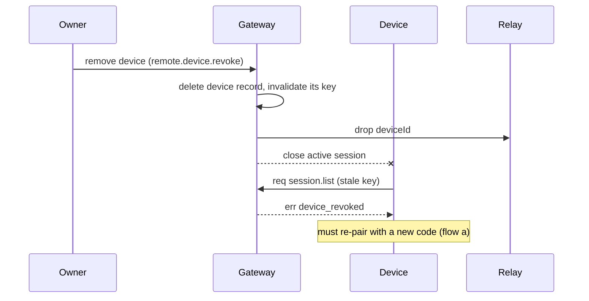

# Remote mode: sequence diagrams

**Status: design.** Written 15 October 2026 as part of FIX24. These diagrams describe the
intended wire behaviour from [PROTOCOL.md](PROTOCOL.md); they do not claim the flows are
implemented. Section numbers below (for example `PROTOCOL §4.3`) refer to that document.
Participants are **Device**, **Relay**, **Gateway** and **Daemon**; **Owner** is the human on
the host making a local decision.

---

## (a) Pairing with a one-time code

Reference: PROTOCOL §4.3 (pairing), §2.1 (transport), §5 (relay framing).

The Owner enables Remote on the host and the Gateway mints a single-use code (eight characters,
five-minute life); the Owner shows that code to the Device by scanning the QR or typing it. The
Device opens a WebSocket to the Relay and addresses the host by `hostId`; the Relay forwards an
opaque `hello` frame without reading its contents. Device and Gateway then run a Noise `XX`
handshake whose prologue folds `H(code ‖ hostId ‖ deviceId ‖ relay)`, so the Relay cannot
substitute keys without breaking the handshake. On success the Gateway assigns a device id and
tier, spends the offer, stores the device record, and returns the pairing result; later
connections use Noise `IK` and no code.

---

## (b) First connect after pairing

Reference: PROTOCOL §4.1–§4.2 (Noise `IK`), §6 (resume/replay), §7 (snapshot filtering).

A known Device reconnects with Noise `IK`, proving identity from its stored non-extractable key
and authenticating the host by its static key; no one-time code is needed. After the secure
channel is up the Gateway sends a redacted `app.snapshot` (per §7) so the Device has a full state
and a starting `sequence`, then the Device subscribes to live events with `afterSequence` set to
that snapshot sequence. The subscription is registered before replay, so the Device may see
duplicate sequences and discards them.

---

## (c) Reconnect with replay and a `replay.gap`

Reference: PROTOCOL §6 (resume and replay), §3 (`replay_gap`).

On reconnect the Device sends its per-host cursor (highest applied `sequence`). The Gateway asks
the Daemon to replay events after that cursor in batches of 1000. If retention still covers the
gap the Device receives the missing events and then live events, deduping by sequence. If the
cursor is older than retention the Daemon reports `replayAvailable:false` with an
`earliestSequence` (or the live socket emits `replay.gap` and closes when a slow client lags);
the Device then fetches a fresh redacted snapshot and resumes from that snapshot's sequence.

---

## (d) A chat prompt through the gateway including tier check and audit write

Reference: PROTOCOL §8 (allowlist/tiers), §3 (frames), §9 (attachments), §11 (dispatch).

The Device sends `session.prompt` as an ordinary daemon request inside the secure channel. The
Gateway parses the envelope, looks the method up in the tier table, checks the Device holds at
least the `chat` tier (and any per-method conditions), rejects any attachment object carrying a
`path`, and only then calls internal daemon dispatch. After the Daemon acknowledges, the Gateway
appends one content-free audit entry and returns the result; the resulting turn events flow back
over the same channel with replay semantics.

---

## (e) A denied call

Reference: PROTOCOL §11 (denied call), §8 (never-remote), §3 (gateway error codes).

The Gateway denies before the Daemon is ever asked to evaluate remote policy. A method with no
rule (or a `never` rule) returns `forbidden_remote`; a known method at a tier the Device does not
hold returns `tier_required`; an operator-only method while approvals from remote are off returns
`approvals_disabled`. Each denial is a normal daemon envelope with `ok:false` and a gateway code.

---

## (f) Host goes to sleep and the device shows asleep

Reference: PROTOCOL §10 (presence and notifications), ARCHITECTURE §4 (offline).

When the host computer sleeps, the Gateway's link to the Relay drops. The Relay holds no state
and queues nothing, so the Device sees its connection go quiet; the client moves that host to
`asleep` (distinct from `offline`) and shows a last-seen time rather than pretending state is
current. A `wake` frame is content-free and can only prompt a check-in; it cannot wake the
computer. On resume the Device reconnects and replays from its cursor.

---

## (g) Revoking a device

Reference: ARCHITECTURE §3 (revocation), PROTOCOL §3 (`device_revoked`), §10.

The Owner removes a paired device on the host. The Gateway deletes the device record, closes its
active session and tells the Relay to drop that device id, so its key is dead immediately; any
in-flight or later call from that device fails with `device_revoked`. The device must pair again
with a new one-time code to be restored.

