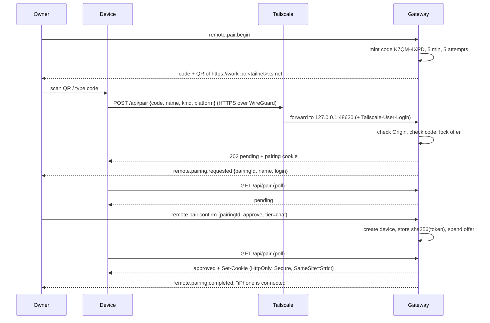
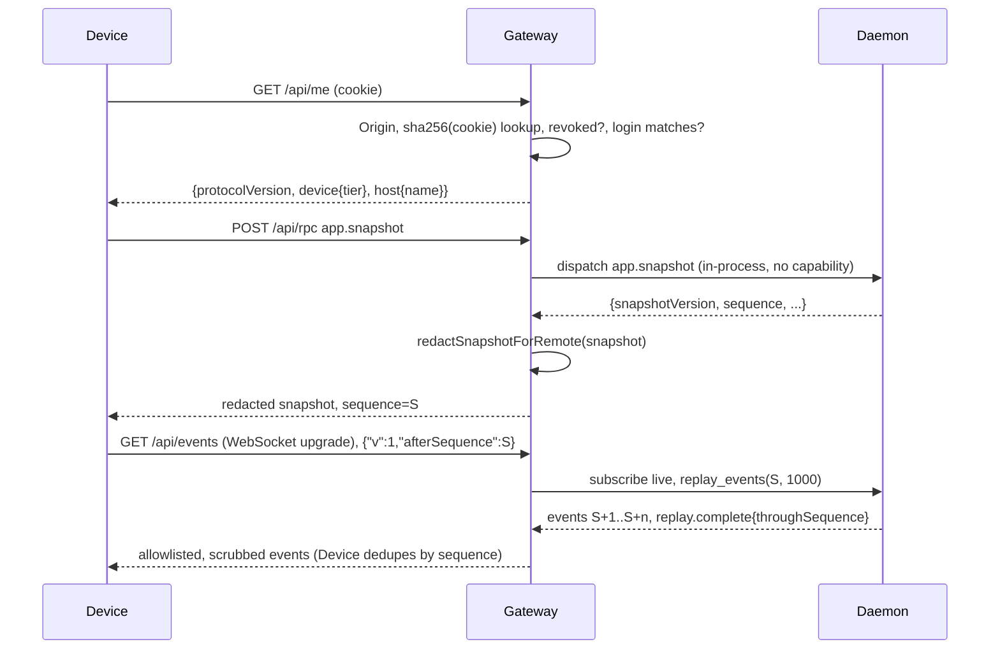
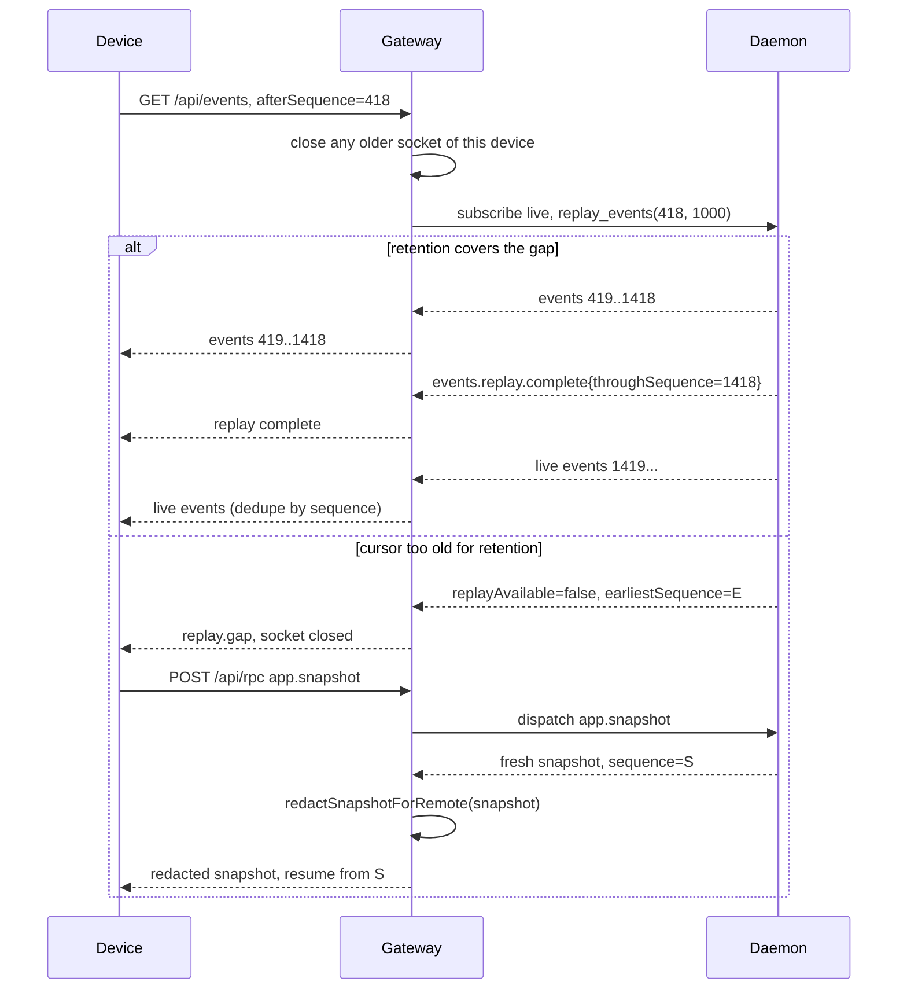
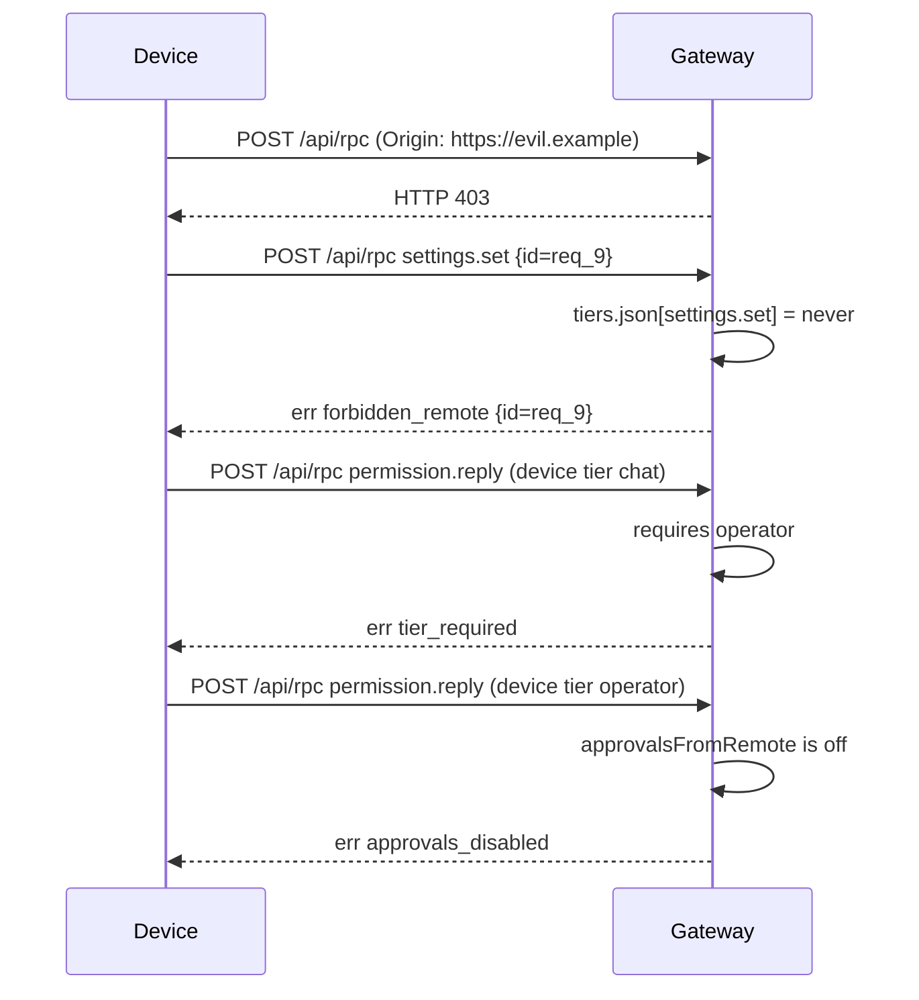
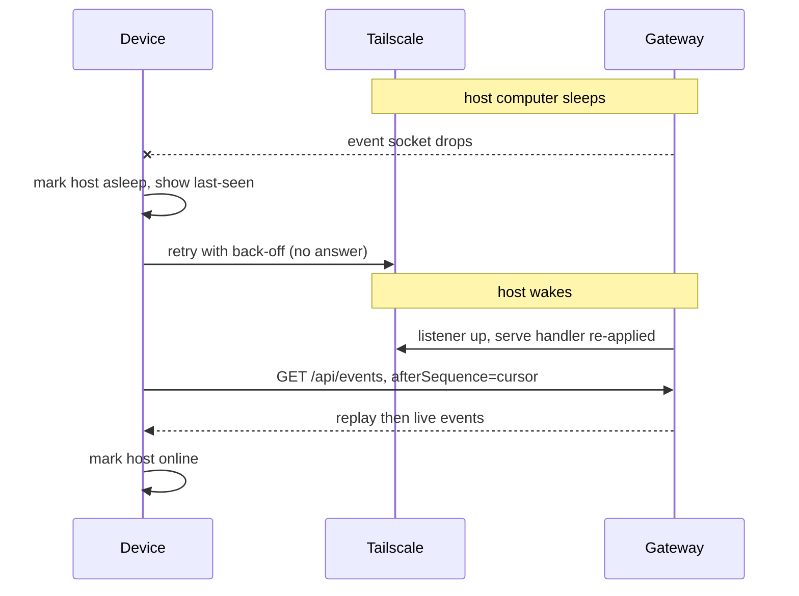
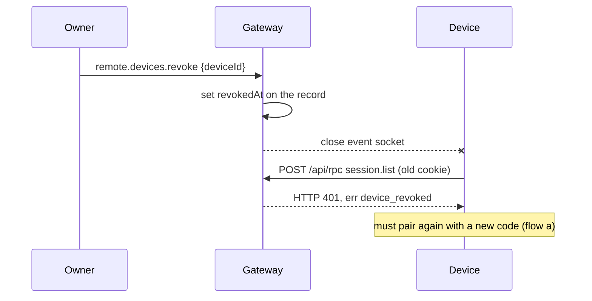

# Remote mode: sequence diagrams

**Status: design.** Written 15 October 2026 as part of FIX24; rewritten 16 October 2026 for
the owner's choice of Tailscale. The 15 October diagrams (relay, Noise XX/IK handshakes) are
superseded and are in git history. These diagrams describe the intended behaviour from
[PROTOCOL.md](PROTOCOL.md); they do not claim the flows are implemented. Section numbers below
(for example `PROTOCOL §4.3`) refer to that document. Participants are **Device** (the PWA),
**Tailscale** (`tailscaled` on the host, which terminates HTTPS and forwards to loopback),
**Gateway** (the second listener in `bitbotsd`) and **Daemon** (in-process dispatch); **Owner**
is the human on the host making a local decision.

---

## (a) Pairing with a one-time code and owner approval

Reference: PROTOCOL §4.3 (pairing), §4.2 (cookie), §2.1 (listener and serve).

The Owner turns Remote on and asks for a code. The Gateway mints an 8-character code valid for
five minutes with five attempts. The Device opens the serve address from the QR and posts the
code. The first correct code locks the offer. The Owner sees the device and its Tailscale login
and approves it with a tier. The Device's next poll receives the cookie; the host stores only
its hash.



---

## (b) First connect after pairing

Reference: PROTOCOL §4.1 (checks), §6 (resume/replay), §7 (snapshot filtering).

The Device calls `/api/me` to learn its tier, then `app.snapshot` through `/api/rpc`. The
Gateway checks Origin, cookie and login, dispatches in-process with no capability, and redacts
the result. The Device then opens the event socket with the snapshot's sequence. The
subscription is registered before replay, so the Device may see duplicate sequences and
discards them.



---

## (c) Reconnect with replay and a `replay.gap`

Reference: PROTOCOL §6 (resume and replay), §3 (`replay_gap`).

On reconnect the Device sends its cursor. If retention still covers the gap the Device receives
the missing events and then live events. If the cursor is older than retention, or a slow client
lags, the Device fetches a fresh redacted snapshot and resumes from its sequence.



---

## (d) A chat prompt through the gateway

Reference: PROTOCOL §4.5 (pipeline), §8 (allowlist/tiers), §9 (attachments).

The Device posts `session.prompt` to `/api/rpc`. The Gateway runs auth, quiet hours, the tier
policy and the parameter rules (no attachments in v1), then dispatches in-process, redacts the
result and writes one content-free activity line.

```mermaid
sequenceDiagram
    participant Device
    participant Gateway
    participant Daemon

    Device->>Gateway: POST /api/rpc session.prompt {sessionId, text}
    Gateway->>Gateway: auth (Origin, cookie, login)
    Gateway->>Gateway: quiet hours off?
    Gateway->>Gateway: tiers.json: session.prompt needs chat; device holds chat
    Gateway->>Gateway: param rules: no attachments
    Gateway->>Daemon: dispatch session.prompt (in-process)
    Daemon-->>Gateway: ok, turn admitted
    Gateway->>Gateway: redactResultForRemote, audit: kind=prompt, device (no content)
    Gateway-->>Device: result {turnId, ...}
    Daemon-->>Gateway: events message.delta / turn.completed
    Gateway-->>Device: allowlisted events on /api/events
```

---

## (e) Denied calls

Reference: PROTOCOL §4.1, §4.5, §11 (denied call), §3 (gateway error codes).

The Gateway denies before the Daemon is asked. A request from another origin is refused at
HTTP level. A `never` method returns `forbidden_remote`; a method above the device's tier returns
`tier_required`; `permission.reply` while approvals from remote are off returns
`approvals_disabled`; any write during quiet hours returns `quiet_hours`.



---

## (f) Host goes to sleep and the device shows asleep

Reference: PROTOCOL §10 (presence), ARCHITECTURE §4 (offline).

When the host sleeps, its tailnet address stops answering and the Device's socket drops. Nothing
is queued anywhere. The client marks the host asleep or offline and shows the last-seen time.
When the host wakes, the daemon listens again and re-applies its serve handler; the Device
reconnects and replays from its cursor.



---

## (g) Revoking a device

Reference: ARCHITECTURE §3 (revocation), PROTOCOL §3 (`device_revoked`).

The Owner removes a paired device on the host. The Gateway marks the record revoked (it keeps
the hash only so it can answer `device_revoked`) and closes the device's socket. Any later request fails with `device_revoked`. The device
must pair again with a new code. There is no third party to notify.


